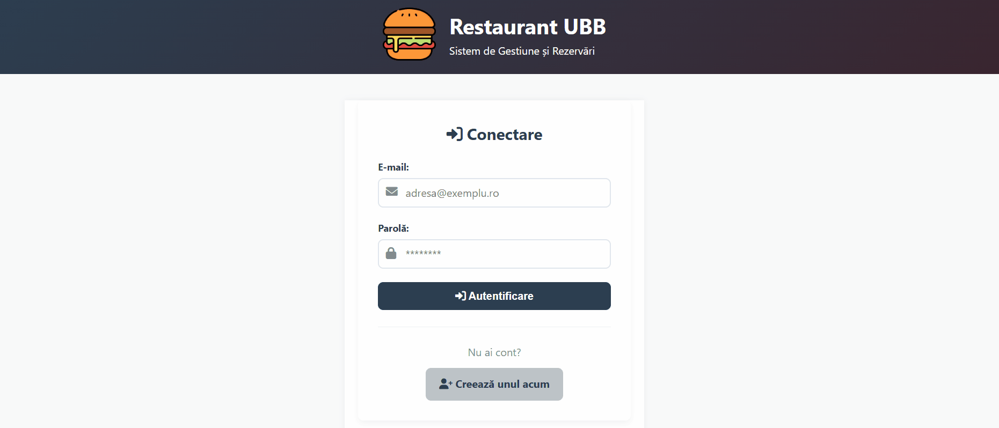
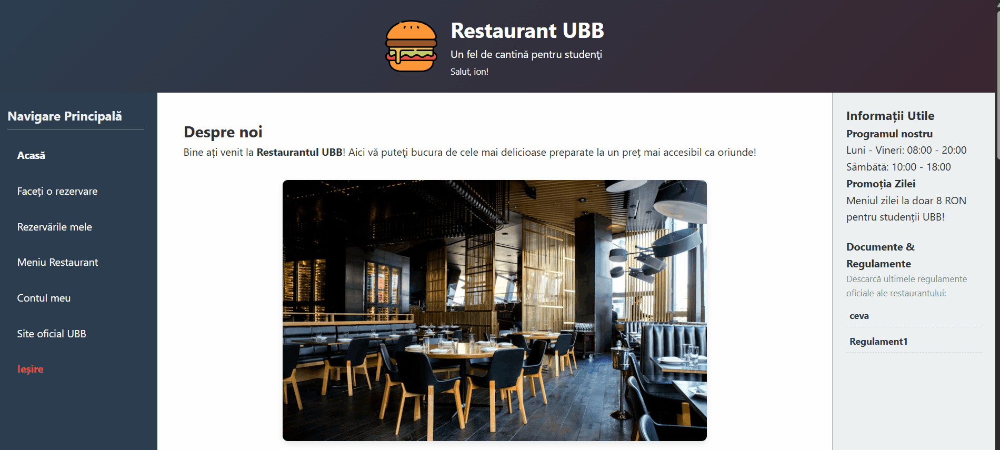
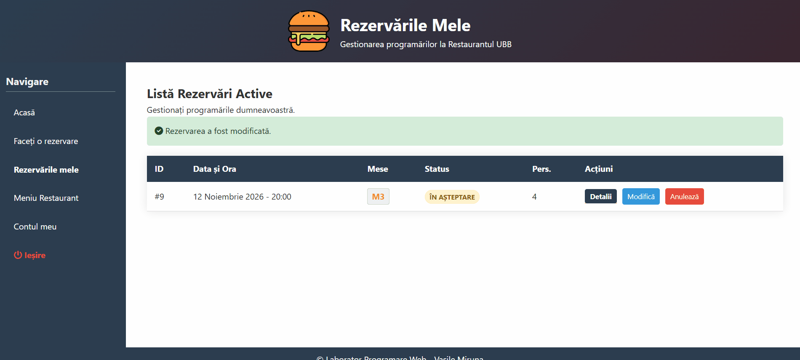
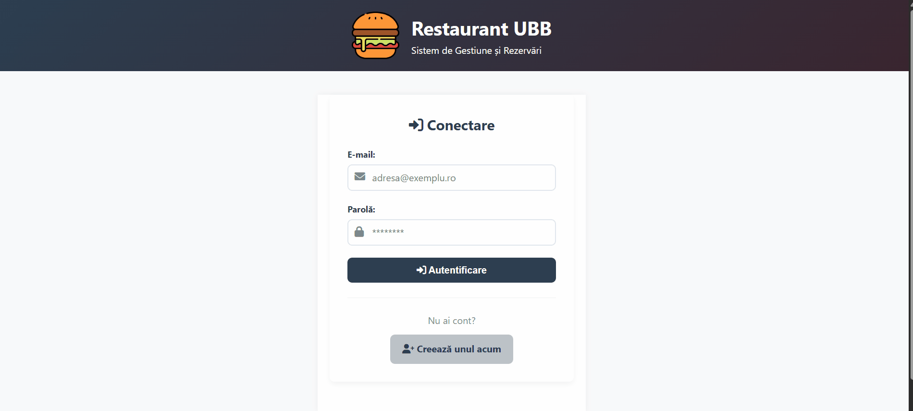
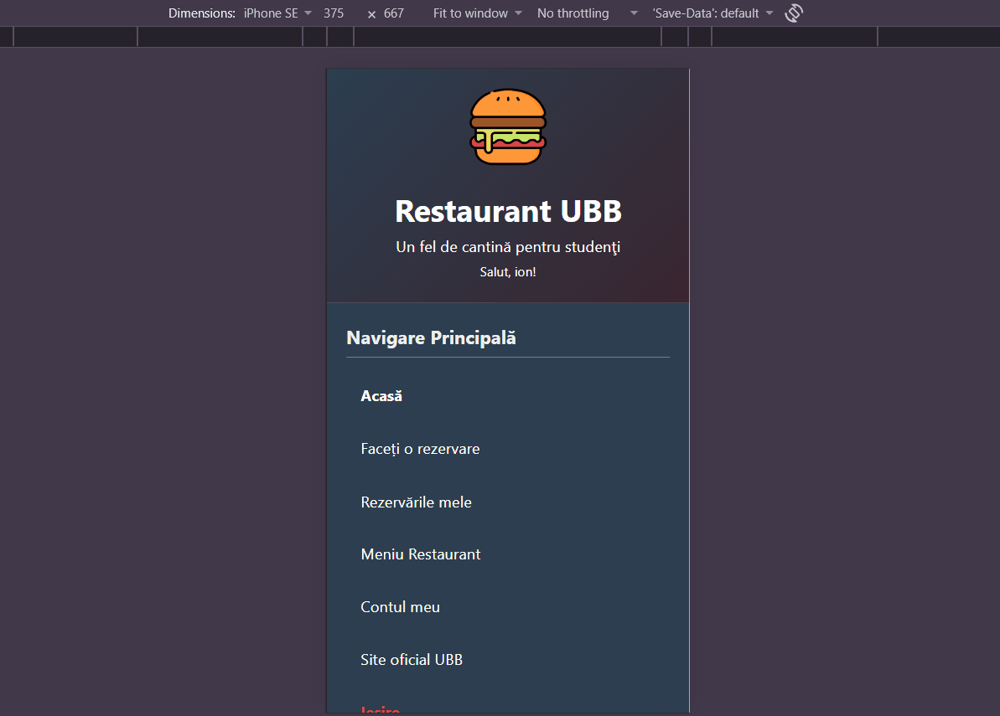

# Cafeteria-Web-App

A complete web platform built for Restaurant UBB, designed to simplify the dining experience for students and staff. The application features a modern, mobile-ready interface that handles user authentication, interactive table reservations, loyalty programs, and a comprehensive administration dashboard.

---

##  Technology Stack
* **Frontend:** HTML5, CSS3, JavaScript
* **Backend:** PHP
* **Database:** MySQL / MariaDB 

---

## Key Features & Walkthrough

### Authentication & Account Creation
A smooth and secure entry point into the application.
* **Quick Registration:** New users can easily create an account to access the platform.
* **Secure Login:** Existing clients authenticate using their email and password.
* **Intuitive Flow:** Seamless transition between login and registration pages.

 

---

### Home Page & Client Dashboard
The landing experience, showcasing the restaurant and providing essential information.
* **Interactive Showcase:** Dynamic, customizable sliders present the restaurant's atmosphere and signature dishes.
* **Media Controls:** Users can play, pause, and adjust the transition speed of the visual galleries.
* **Official Documents Access:** A dedicated sidebar panel provides quick downloads for official rules and regulations managed by the administration.
* **Centralized Navigation:** Easy access to reservations, menus, and account settings.

---

### Advanced Reservation System
A streamlined, visual approach to booking a table.
* **Two-Step Booking:** Users first select the date, time, party size, and add special requests.
* **Interactive Floor Plan:** Clients view a visual map of the restaurant (Window, Interior, Terrace) with real-time availability indicators (Green = Free, Red = Occupied) to pick their exact table.
* **Reservation Management:** A dedicated "My Reservations" panel allows users to track booking status (e.g., PENDING, ACCEPTED), view details, modify times, or cancel active requests.

---

### User Profile & Loyalty Program
A gamified and personalized account area.
* **Feedback & Reviews:** Clients can leave star ratings and comments on their experience, while tracking their overall review average.
* **Gamified Loyalty System:** A visual progress bar displays loyalty points earned. Users can easily see how many points they need to reach the next discount tier (e.g., "Silver" status).
* **Profile Customization:** Users can upload avatars and update personal details (contact info, location, preferences).
* **Security:** A secure pop-up flow for changing account passwords.

---

### Administration Dashboard
A powerful back-office suite for restaurant management and staff.
* **Reservation Control:** Staff can view all incoming booking requests in a detailed table and easily mark them as `ACCEPTED` (reserving the table) or `REJECTED` (freeing the slot).
* **Document Management:** Administrators can upload, manage, and delete official files (PDF, DOCX, etc.) that appear on the client home page.
* **Internal Communication:** A dedicated announcement board for staff regarding mandatory meetings or new regulations.
* **Staff Management:** Ability to create new administrator accounts with appropriate privileges.

---

> **Mobile-Ready:** The entire platform is fully responsive, ensuring a seamless experience whether accessed from a desktop computer, tablet, or smartphone.

 
